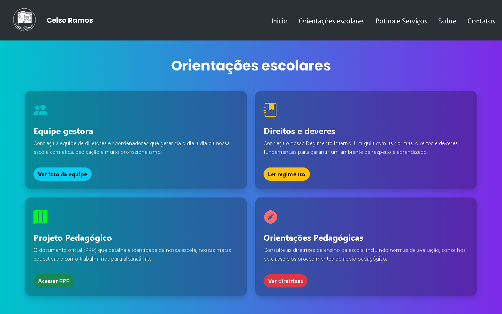

<div align="center">

# EEM Governador Celso Ramos

**Portal informativo da escola — orientações, rotina, serviços e documentos oficiais em um só lugar.**

[](https://celso-ramos.vercel.app)




</div>

## Sobre

Site institucional criado para a **Escola de Ensino Médio Governador Celso Ramos** (Joinville/SC). Reúne, em uma navegação simples, o que alunos e responsáveis mais procuram: quem faz a gestão da escola, quais são os direitos e deveres, o projeto pedagógico, as orientações de rotina e os contatos.

Todo o conteúdo é estático (HTML + CSS), sem build e sem dependências: basta abrir o `index.html`.

## Seções

| Seção | O que tem |
|---|---|
| **Início** | Apresentação da escola e atalhos para as áreas principais |
| **Orientações escolares** | Equipe gestora, direitos e deveres, PPP e orientações pedagógicas |
| **Rotina e Serviços** | Horários, merenda, secretaria e demais serviços do dia a dia |
| **Sobre** | Identidade e história da escola |
| **Contatos** | Telefone, endereço e canais de atendimento |

Documentos oficiais disponíveis: **PPP 2025**, **Regimento Escolar 2026**, **Calendário** e **Orientações Escolares**.

## Estrutura

```
Celso_ramos/
├─ index.html          página única com todas as seções
├─ img/                logo, fotos da equipe e documentos (PDF)
└─ assets/
   └─ preview.png      prévia usada neste README
```

## Como rodar

Não precisa de servidor nem de instalação:

```bash
git clone https://github.com/CarlosDuhring/Celso_ramos.git
cd Celso_ramos
# abra o index.html no navegador
```

## Decisões de projeto

- **HTML semântico** (`header`, `nav`, `section`, `footer`) para leitores de tela e SEO.
- **Layout responsivo** com CSS Grid e Flexbox, sem framework.
- **Contraste e foco visível** nos botões e links, pensando em acessibilidade.
- **Zero dependências**: o site carrega rápido e funciona offline (exceto os PDFs).

---

<sub>Desenvolvido por **Carlos Eduardo Duhring** · [github.com/CarlosDuhring](https://github.com/CarlosDuhring)</sub>
